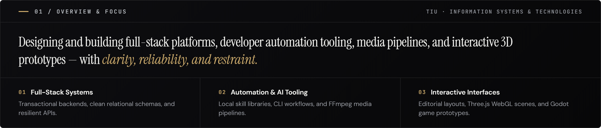
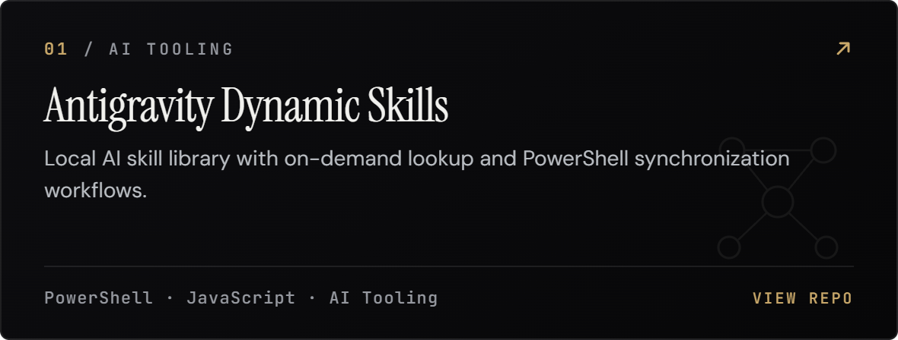
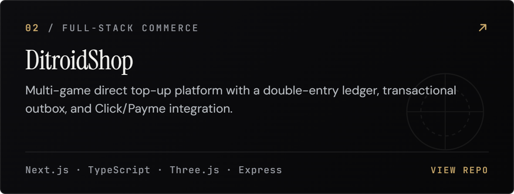
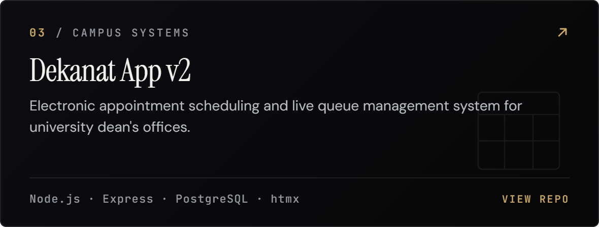
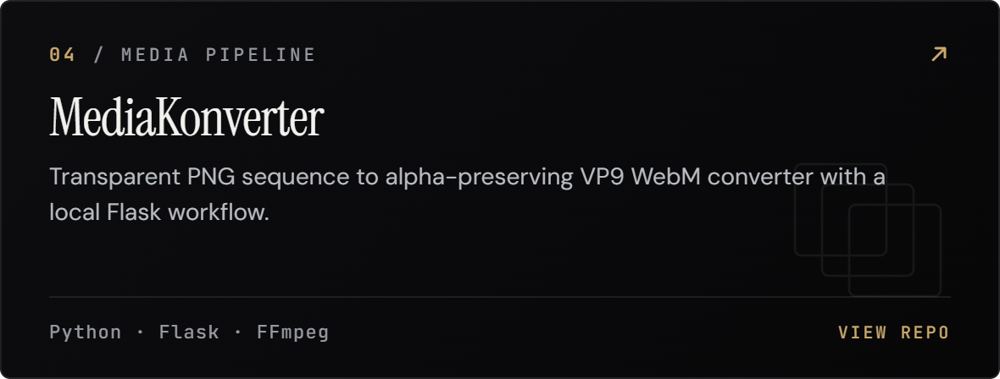
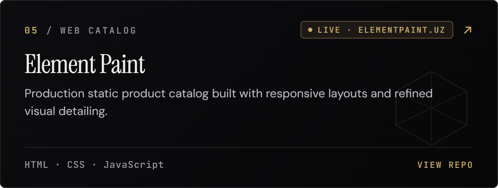
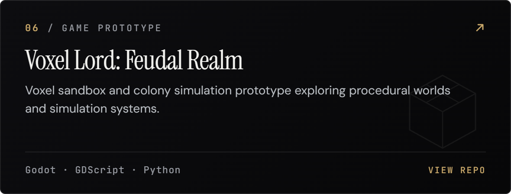
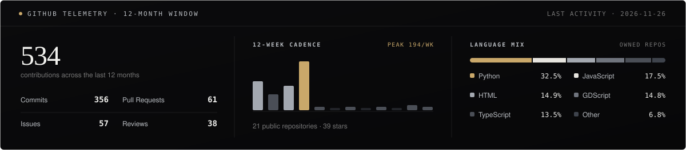
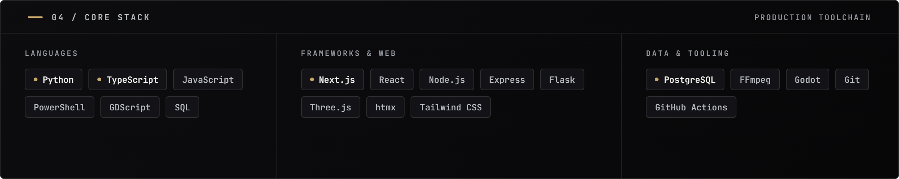
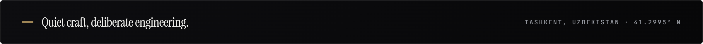

  <picture>
    <source media="(prefers-color-scheme: dark)" srcset="assets/profile-header-dark.png" />
    <source media="(prefers-color-scheme: light)" srcset="assets/profile-header-light.png" />
    
  </picture>

  <a href="https://github.com/dilmurodmuxsinjonov"><picture><source media="(prefers-color-scheme: dark)" srcset="assets/nav-github-dark.svg" /><source media="(prefers-color-scheme: light)" srcset="assets/nav-github-light.svg" /></picture></a>&nbsp;&nbsp;<a href="https://t.me/dilmurod_muhsinjanov"><picture><source media="(prefers-color-scheme: dark)" srcset="assets/nav-telegram-dark.svg" /><source media="(prefers-color-scheme: light)" srcset="assets/nav-telegram-light.svg" /></picture></a>&nbsp;&nbsp;<a href="https://www.linkedin.com/in/dilmurod-muhsinjanov-dm093zz"><picture><source media="(prefers-color-scheme: dark)" srcset="assets/nav-linkedin-dark.svg" /><source media="(prefers-color-scheme: light)" srcset="assets/nav-linkedin-light.svg" /></picture></a>

  <picture>
    <source media="(prefers-color-scheme: dark)" srcset="assets/section-about-dark.png" />
    <source media="(prefers-color-scheme: light)" srcset="assets/section-about-light.png" />
    
  </picture>

  <picture>
    <source media="(prefers-color-scheme: dark)" srcset="assets/header-work-dark.svg" />
    <source media="(prefers-color-scheme: light)" srcset="assets/header-work-light.svg" />
    
  </picture>

  <a href="https://github.com/dilmurodmuxsinjonov/antigravity-dynamic-skills"><picture><source media="(prefers-color-scheme: dark)" srcset="assets/card-01-antigravity-dark.png" /><source media="(prefers-color-scheme: light)" srcset="assets/card-01-antigravity-light.png" /></picture></a>&nbsp;<a href="https://github.com/dilmurodmuxsinjonov/ditroidshop"><picture><source media="(prefers-color-scheme: dark)" srcset="assets/card-02-ditroidshop-dark.png" /><source media="(prefers-color-scheme: light)" srcset="assets/card-02-ditroidshop-light.png" /></picture></a>

  <a href="https://github.com/dilmurodmuxsinjonov/talabalaramalyotkundaligi"><picture><source media="(prefers-color-scheme: dark)" srcset="assets/card-03-dekanat-dark.png" /><source media="(prefers-color-scheme: light)" srcset="assets/card-03-dekanat-light.png" /></picture></a>&nbsp;<a href="https://github.com/dilmurodmuxsinjonov/MediaKonverter"><picture><source media="(prefers-color-scheme: dark)" srcset="assets/card-04-mediakonverter-dark.png" /><source media="(prefers-color-scheme: light)" srcset="assets/card-04-mediakonverter-light.png" /></picture></a>

  <a href="https://github.com/dilmurodmuxsinjonov/elementpaint"><picture><source media="(prefers-color-scheme: dark)" srcset="assets/card-05-elementpaint-dark.png" /><source media="(prefers-color-scheme: light)" srcset="assets/card-05-elementpaint-light.png" /></picture></a>&nbsp;<a href="https://github.com/dilmurodmuxsinjonov/my-game"><picture><source media="(prefers-color-scheme: dark)" srcset="assets/card-06-voxellord-dark.png" /><source media="(prefers-color-scheme: light)" srcset="assets/card-06-voxellord-light.png" /></picture></a>

  Live production catalog: <a href="https://elementpaint.uz/">elementpaint.uz</a>

  <picture>
    <source media="(prefers-color-scheme: dark)" srcset="assets/header-telemetry-dark.svg" />
    <source media="(prefers-color-scheme: light)" srcset="assets/header-telemetry-light.svg" />
    
  </picture>

  <picture>
    <source media="(prefers-color-scheme: dark)" srcset="assets/telemetry-dark.svg" />
    <source media="(prefers-color-scheme: light)" srcset="assets/telemetry-light.svg" />
    
  </picture>

  <picture>
    <source media="(prefers-color-scheme: dark)" srcset="assets/section-stack-dark.png" />
    <source media="(prefers-color-scheme: light)" srcset="assets/section-stack-light.png" />
    
  </picture>

  <picture>
    <source media="(prefers-color-scheme: dark)" srcset="assets/section-footer-dark.png" />
    <source media="(prefers-color-scheme: light)" srcset="assets/section-footer-light.png" />
    
  </picture>

