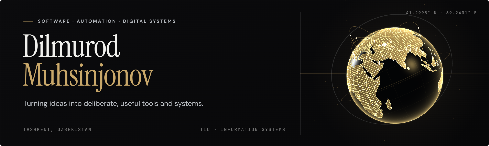

  <picture>
    <source media="(prefers-color-scheme: dark)" srcset="assets/profile-header-dark.png" />
    <source media="(prefers-color-scheme: light)" srcset="assets/profile-header-light.png" />
    
  </picture>

  <a href="https://github.com/dilmurodmuxsinjonov">GitHub</a> &nbsp; &#183; &nbsp;
  <a href="https://t.me/dilmurod_muhsinjanov">Telegram</a> &nbsp; &#183; &nbsp;
  <a href="https://www.linkedin.com/in/dilmurod-muhsinjanov-dm093zz">LinkedIn</a>

### About

I'm **Dilmurod Muhsinjonov**, an Information Systems & Technologies student at **Tashkent International University**. I design and build full-stack web platforms, developer automation tooling, media processing pipelines, and interactive 3D and game prototypes with an emphasis on clarity, reliability, and restraint.

- **Full-Stack Systems** — transactional backends, clean relational schemas, and resilient API workflows.
- **Automation & AI Tooling** — local skill libraries, synchronization scripts, and developer productivity utilities.
- **Interactive Interfaces** — editorial layouts, responsive web catalogs, and real-time 3D/game experiments.

### Selected Work

<table>
  <tr>
    <td width="50%" valign="top">
      01 / AI TOOLING
      <h4><a href="https://github.com/dilmurodmuxsinjonov/antigravity-dynamic-skills">Antigravity Dynamic Skills</a></h4>
      
Local AI skill library with on-demand lookup and PowerShell synchronization workflows.

      PowerShell &#183; JavaScript &#183; AI Tooling
    </td>
    <td width="50%" valign="top">
      02 / FULL-STACK COMMERCE
      <h4><a href="https://github.com/dilmurodmuxsinjonov/ditroidshop">DitroidShop</a></h4>
      
Multi-game direct top-up platform with a double-entry ledger, transactional outbox, and Click/Payme integration.

      Next.js &#183; TypeScript &#183; Three.js &#183; Express
    </td>
  </tr>
  <tr>
    <td width="50%" valign="top">
      03 / CAMPUS SYSTEMS
      <h4><a href="https://github.com/dilmurodmuxsinjonov/talabalaramalyotkundaligi">Dekanat App v2</a></h4>
      
Electronic appointment scheduling and live queue management system for university dean's offices.

      Node.js &#183; Express &#183; PostgreSQL &#183; htmx
    </td>
    <td width="50%" valign="top">
      04 / MEDIA PIPELINE
      <h4><a href="https://github.com/dilmurodmuxsinjonov/MediaKonverter">MediaKonverter</a></h4>
      
Transparent PNG sequence to alpha-preserving VP9 WebM converter with a local Flask workflow.

      Python &#183; Flask &#183; FFmpeg
    </td>
  </tr>
  <tr>
    <td width="50%" valign="top">
      05 / WEB CATALOG
      <h4><a href="https://github.com/dilmurodmuxsinjonov/elementpaint">Element Paint</a> &nbsp;<a href="https://elementpaint.uz/">Live &#8599;</a></h4>
      
Production static product catalog built with responsive layouts and refined visual detailing.

      HTML &#183; CSS &#183; JavaScript
    </td>
    <td width="50%" valign="top">
      06 / GAME PROTOTYPE
      <h4><a href="https://github.com/dilmurodmuxsinjonov/my-game">Voxel Lord: Feudal Realm</a></h4>
      
Voxel sandbox and colony simulation prototype built with Godot.

      Godot &#183; GDScript &#183; Python
    </td>
  </tr>
</table>

### Engineering Telemetry

  <picture>
    <source media="(prefers-color-scheme: dark)" srcset="assets/telemetry-dark.svg" />
    <source media="(prefers-color-scheme: light)" srcset="assets/telemetry-light.svg" />
    
  </picture>

Self-hosted SVG telemetry generated from the GitHub GraphQL API and refreshed daily via <a href=".github/workflows/update-profile.yml">GitHub Actions</a>.

### Core Stack

| Layer | Technologies |
| :--- | :--- |
| **Languages** | `Python` · `TypeScript` · `JavaScript` · `PowerShell` · `GDScript` · `SQL` |
| **Frameworks & Web** | `Next.js` · `React` · `Node.js` · `Express` · `Flask` · `Three.js` · `htmx` · `Tailwind CSS` |
| **Data & Tooling** | `PostgreSQL` · `FFmpeg` · `Godot` · `Git` · `GitHub Actions` |

---

Tashkent, Uzbekistan &nbsp; &#183; &nbsp; Quiet craft, deliberate engineering.
