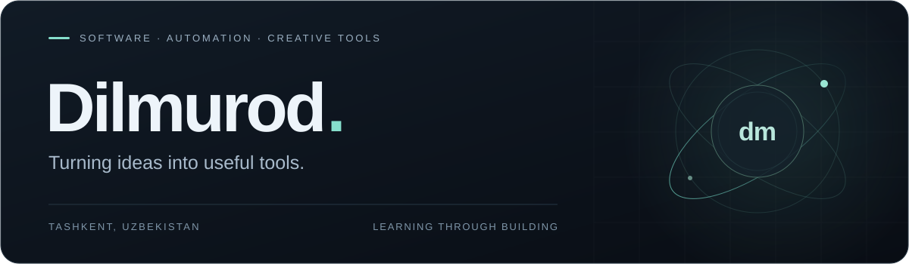

  

  <a href="https://github.com/dilmurodmuxsinjonov">GitHub</a> &nbsp; / &nbsp;
  <a href="https://t.me/dilmurod_muhsinjanov">Telegram</a> &nbsp; / &nbsp;
  <a href="https://www.linkedin.com/in/dilmurod-muhsinjanov-dm093zz">LinkedIn</a>

### A little about me

I'm Dilmurod, an **Information Systems & Technologies student** at Tashkent International University. I build practical tools and explore automation, web interfaces, and game prototypes.

### Selected work

<table>
  <tr>
    <td width="50%" valign="top">
      01 / DEVELOPER TOOLS
      <h4><a href="https://github.com/dilmurodmuxsinjonov/antigravity-dynamic-skills">Antigravity Dynamic Skills</a></h4>
      
A local skill library and synchronization workflow for AI agents.

      PowerShell · Developer tooling
    </td>
    <td width="50%" valign="top">
      02 / MEDIA TOOLS
      <h4><a href="https://github.com/dilmurodmuxsinjonov/MediaKonverter">MediaKonverter</a></h4>
      
Convert PNG sequences to WebM while preserving transparency.

      Python · Flask · FFmpeg
    </td>
  </tr>
  <tr>
    <td width="50%" valign="top">
      03 / WEB
      <h4><a href="https://github.com/dilmurodmuxsinjonov/elementpaint">Element Paint</a></h4>
      
A static product catalog with responsive interfaces and visual details.

      HTML · CSS · JavaScript
    </td>
    <td width="50%" valign="top">
      04 / GAME PROTOTYPE
      <h4><a href="https://github.com/dilmurodmuxsinjonov/my-game">Voxel Lord: Feudal Realm</a></h4>
      
A voxel sandbox and colony simulation project, developed as a prototype.

      Godot · GDScript · Python
    </td>
  </tr>
</table>

### Working with

<code>Python</code> &nbsp; <code>TypeScript</code> &nbsp; <code>JavaScript</code> &nbsp; <code>PowerShell</code> &nbsp; <code>Node.js</code> &nbsp; <code>Git</code>

---

Tashkent, Uzbekistan &nbsp; · &nbsp; Learning through building.
